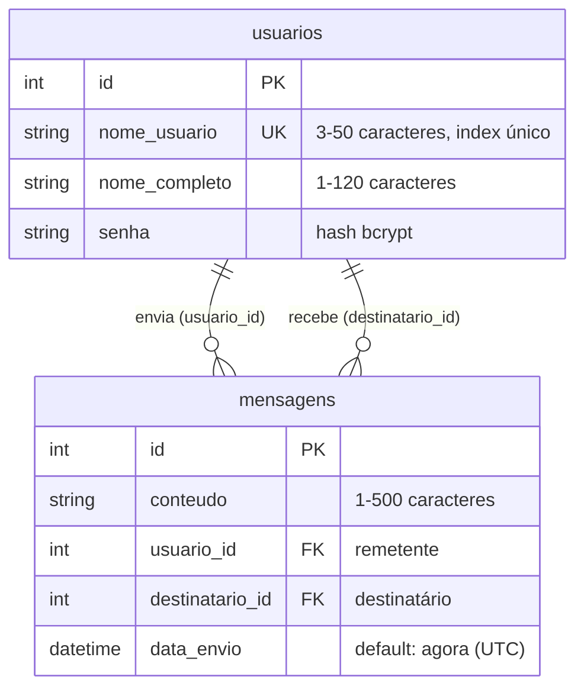
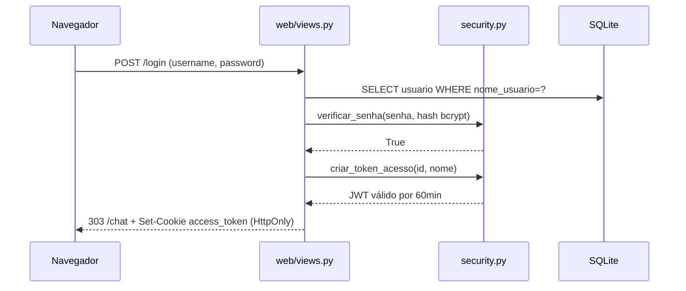
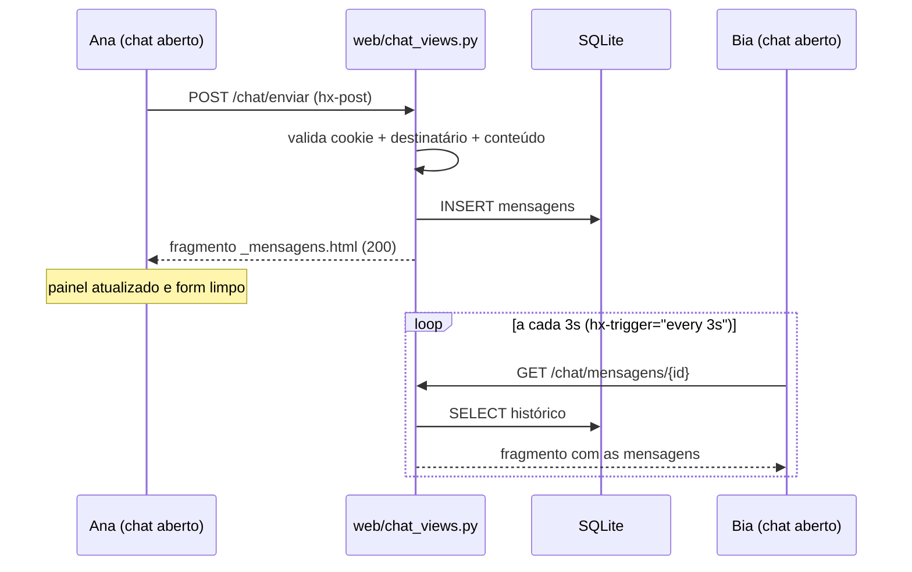

# 01 · Arquitetura do CHATLOCAL

> Visão geral do sistema, mapa de módulos, modelo de dados e fluxos principais.

## Visão geral

O CHATLOCAL é uma aplicação full-stack em Python com **dois clientes sobre a mesma base de regras de negócio**:

1. **API REST** (`/api/...`) — consome JSON autenticado por JWT no header `Authorization`
2. **Aplicação web** (`/login`, `/chat`) — páginas HTML geradas com Jinja2 + htmx, autenticadas por cookie httpOnly

```
     ┌──────────────┐          ┌──────────────────┐
     │  Navegador   │          │ Cliente HTTP/API │
     │ (HTML + htmx)│          │   (curl, app)    │
     └──────┬───────┘          └────────┬─────────┘
            │ cookie JWT               │ Bearer JWT
     ┌──────▼───────────────────────────▼─────────┐
     │            FastAPI (core/api.py)          │
     │  CORS · /static · rotas web · rotas API   │
     ├────────────────┬──────────────────────────┤
     │     web/       │  usuario/ · mensagem/    │
     │  views.py      │  api.py (rotas REST)     │
     │  chat_views.py │  services.py (regras)    │
     │  templates/    │  models.py · schemas.py  │
     │  static/       │  security.py (JWT/bcrypt)│
     ├────────────────┴──────────────────────────┤
     │        database/ (engine + sessão)        │
     │            SQLite: chatlocal.db           │
     └───────────────────────────────────────────┘
```

## Mapa de módulos

| Pasta | Responsabilidade | Arquivos |
|---|---|---|
| `core/` | Composição da aplicação | `api.py` — cria o `app`, CORS, `/static`, registra todos os routers |
| `database/` | Infraestrutura de dados | `connection.py` (engine/sessão), `session.py` (`obter_sessao`), `registry.py`, `init_db.py` |
| `usuario/` | Usuários e autenticação | `api.py`, `services.py`, `models.py`, `schemas.py`, `security.py` |
| `mensagem/` | Mensagens | `api.py`, `services.py`, `models.py`, `schemas.py` |
| `web/` | Frontend server-side | `views.py` (login/registo/logout), `chat_views.py` (chat), `templates/`, `static/` |
| raiz | Entrada e configuração | `main.py`, `.env`, `requirements.txt`, `README.md` |

**Regra de dependência: rota → service → model.** As rotas (`api.py`, `views.py`, `chat_views.py`) só orquestram: validam, chamam `services.py` e devolvem a resposta. As regras de negócio vivem em `services.py`. Nunca há SQL nas rotas.

## Modelo de dados



- ORM: SQLAlchemy 2.0 no padrão `registry` + `mapped_as_dataclass` (`database/registry.py`)
- Um chat privado entre A e B são as mensagens com `(usuario_id=A AND destinatario_id=B) OR (usuario_id=B AND destinatario_id=A)`
- O histórico usa `joinedload`, então 2 usuários = **1 única query** (evita o problema N+1)

## Fluxos principais

### Login (camada web)



### Envio e recebimento de mensagens



## Camada web vs API

| | API REST | Camada web |
|---|---|---|
| Regras de negócio | `services.py` | **as mesmas** (reutiliza as funções) |
| Autenticação | header `Authorization: Bearer` | cookie `access_token` (httpOnly) |
| Formato | JSON + Pydantic | HTML + Jinja2 |
| Sessão no servidor | nenhuma (stateless) | nenhuma — o próprio JWT carrega a identidade |

Essa decisão mantém o servidor **stateless**: adicionar réplicas ou trocar o banco não quebra a autenticação.

## Pontos de extensão
- `web/` é um pacote isolado: páginas novas = novo arquivo de rotas + templates, sem tocar no domínio
- WebSocket/SSE entrará como rota adicional no mesmo `app` (ver roadmap no README)
- A API continua sendo o contrato estável para qualquer outro cliente (mobile, tests, automações)